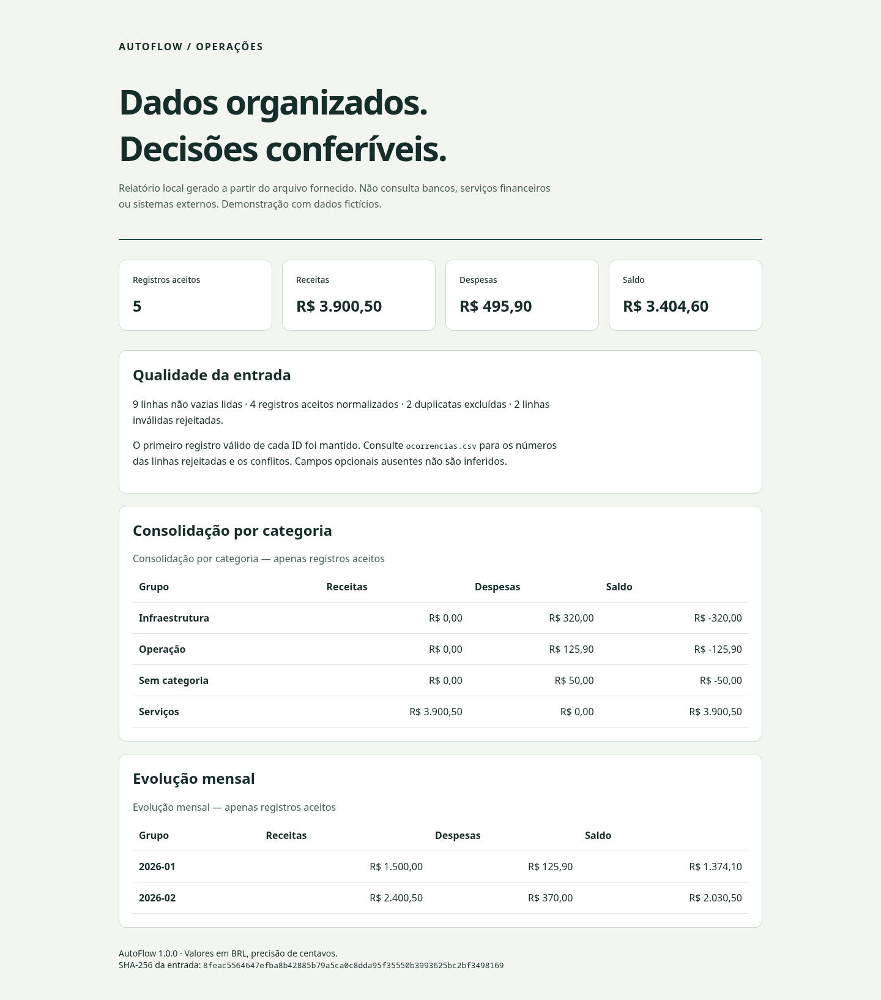

# AutoFlow

Pipeline local de automação administrativa que transforma planilhas CSV/XLSX em registros validados, relatórios de qualidade e consolidações conferíveis. Desenvolvido para demonstrar processamento de dados, regras de domínio, tratamento de falhas e testes automatizados.

Planilhas recebidas de fontes diferentes podem conter valores ambíguos, campos incompletos e IDs repetidos. O AutoFlow aplica um contrato explícito, conserva os números das linhas com problemas e gera saídas sem modificar a entrada.

## Funcionalidades implementadas

- Importação de CSV UTF-8, com ou sem BOM, e XLSX; escolha de aba e separador.
- Normalização de espaços, cabeçalhos, e-mail, datas e valores brasileiros/canônicos.
- Validação por registro, separação de rejeições e identificação de duplicatas e conflitos.
- Primeiro registro válido de cada ID prevalece; linhas inválidas não reservam o ID.
- Valores com `Decimal`: receitas, despesas e saldo por categoria e mês, sem ponto flutuante.
- CSV e XLSX de registros/ocorrências, JSON consolidado, relatório HTML responsivo e log resumido.
- Proteção de exportações contra fórmulas de planilha e escape de conteúdo no HTML.
- Pasta de saída nova, publicação por rename após sucesso e limpeza em falhas tratadas.
- Hash SHA-256 da entrada, limites de tamanho/linhas e modo estrito para automações.

Não envia dados para serviços externos. Todos os exemplos em `examples/` são **fictícios**, inclusive nomes, e-mails e valores. Não exige credenciais.

## Capturas reais

Relatório produzido pelo CLI com os exemplos incluídos, capturado no Chromium:



[Captura em celular, 390 px](docs/relatorio-390.png) · [Captura em tablet, 768 px](docs/relatorio-768.png)

As capturas representam o resultado efetivamente gerado, sem dados reais ou mockups de interface.

## Tecnologias e requisitos

Python 3.11+, openpyxl 3.1.5 e defusedxml 0.7.1. `csv`, `decimal`, `argparse`, `unittest`, `logging` e demais utilitários são da biblioteca padrão. Ruff para lint/formatação; setuptools e build para empacotamento. Não há servidor ou banco de dados.

## Instalação e demonstração

Na raiz deste repositório:

```bash
python3 -m venv .venv
source .venv/bin/activate
# Windows PowerShell: .venv\Scripts\Activate.ps1
python -m pip install .
autoflow examples/registros.csv --output output/demo-csv --demo
autoflow examples/registros.xlsx --output output/demo-xlsx --demo
```

Abra `output/demo-csv/relatorio.html` no navegador. O comando equivalente sem entrypoint é `python -m autoflow`. Escolha outra pasta de saída a cada execução; um destino existente é recusado.

**Resultado esperado do exemplo:** 9 linhas não vazias, 5 aceitas, 2 duplicadas (uma conflitante), 2 inválidas; receitas R$ 3.900,50, despesas R$ 495,90, saldo R$ 3.404,60. Esses números provêm do arquivo fictício incluído.

```bash
autoflow entrada.csv --delimiter ';' --output output/lote-001 --strict
autoflow entrada.xlsx --sheet Registros --output output/lote-002
autoflow --help
```

Retornos: `0` processamento concluído; `2` erro de entrada, configuração ou exportação; `3` relatório gerado com ocorrências em modo `--strict`. Sem `--strict`, rejeições e duplicatas constam nos relatórios e no resumo de execução, mas o retorno permanece `0`.

## Contrato de entrada

| Coluna | Regra |
|---|---|
| `id` | Obrigatório; 1–64 letras ASCII, números, hífen ou underscore. Sensível a maiúsculas. Armazene como texto para preservar zeros à esquerda. |
| `nome` | Obrigatório; até 160 caracteres, espaços normalizados. |
| `email` | Opcional; formato básico validado e convertido para minúsculas; não verifica existência. |
| `categoria` | Opcional; até 80 caracteres; ausente vira `Sem categoria`; caixa preservada. |
| `data` | Obrigatória; data civil válida `AAAA-MM-DD`, `DD/MM/AAAA` ou célula de data XLSX. |
| `tipo` | `receita` ou `despesa`, ignorando caixa e acentuação. |
| `valor` | Positivo, até 999.999.999,99, no máximo duas casas; exemplos: `1234.50`, `1234,50`, `1.234,50`. |

Valores `0`, negativos, notação científica, `NaN`, precisão excessiva e `1.234` ambíguo são rejeitados. O sinal financeiro vem de `tipo`. Cabeçalhos desconhecidos/duplicados são recusados. Fórmulas e células de erro XLSX são rejeitadas, sem cálculo. Linhas vazias são ignoradas. Para campos CSV multilinha, a ocorrência referencia a última linha física do registro.

## Saídas

| Arquivo | Conteúdo |
|---|---|
| `registros.csv` | Registros aceitos, em UTF-8 BOM, separados por `;`. |
| `ocorrencias.csv` | Linha, código, motivo e linha original para duplicatas. Sem copiar valores rejeitados. |
| `resultado.xlsx` | Abas `Registros` e `Ocorrencias`; valores decimais e IDs como texto. |
| `resumo.json` | Contagens, totais, categorias, meses, versão e hash da entrada. |
| `relatorio.html` | Relatório estático acessível, sem JavaScript ou recursos externos. |
| `execucao.log` | Contagens, sem nomes, e-mails ou valores da entrada. |

Texto iniciado por `=`, `+`, `-` ou `@` recebe apóstrofo nas exportações tabulares. Isso protege a abertura em planilhas, mas altera a representação textual exportada. Reimportar CSV exige respeitar esse escape; XLSX de saída tem duas abas, portanto use `--sheet Registros`.

## Testes, lint e build

```bash
python -m pip install -r requirements-dev.txt
python -m unittest discover -s tests -v
ruff check autoflow tests scripts
ruff format --check autoflow tests scripts
python -m build
python scripts/security_audit.py
python -m pip_audit -r requirements.txt
```

Os testes exercitam regras monetárias/datas, normalização, CSV/XLSX, fórmulas, injeção HTML, duplicatas, limites, concorrência de saída, falhas de disco simuladas e o CLI por subprocesso. O audit de fonte requer checkout Git com histórico. GitHub Actions executa lint, testes, build e auditorias; não faz deploy.

## Estrutura

```text
autoflow/          domínio, leitores, exportadores e CLI
tests/             testes unitários e de integração local
examples/          entradas fictícias CSV/XLSX
scripts/           geração do exemplo e auditoria de fonte/histórico
docs/              arquitetura e evidências de validação
.github/workflows/ CI
```

## Limitações e evolução

Processamento em memória, limitado a arquivos de 10 MiB e 100 mil linhas. XLSX: até 50 MiB de conteúdo expandido e mil entradas ZIP. Esses limites não equivalem a sandbox para documentos hostis. Execute em conta sem privilégios e use arquivos de origem conhecida. Não há recuperação de processo interrompido por SIGKILL: uma pasta temporária/lock pode permanecer; remova-a apenas após verificar que não há execução ativa.

Não há múltiplas moedas, conversão cambial, autenticação, colaboração, interface de edição ou integração com ERP. O HTML é um relatório do processamento real, não uma aplicação CRUD. Saídas de dados reais devem permanecer privadas; `output/` é ignorada pelo Git. Não existe demonstração online nesta versão.

Evoluções possíveis: schema configurável, processamento em lotes para volumes maiores, política de conflitos selecionável e interface de revisão. Não foi adicionada licença de redistribuição sem decisão do proprietário.
